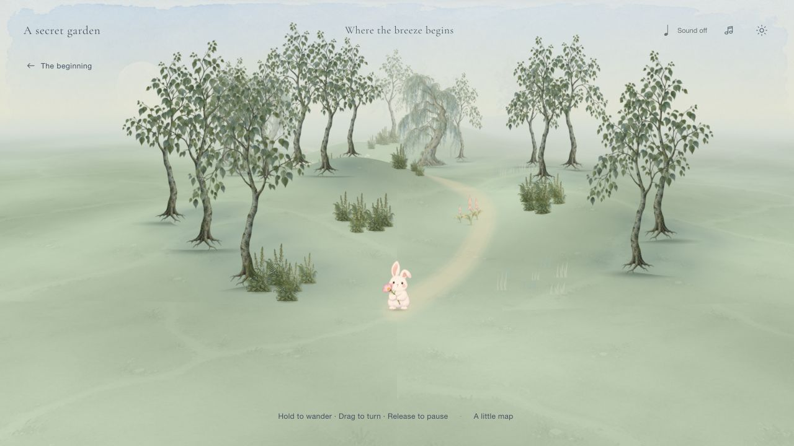
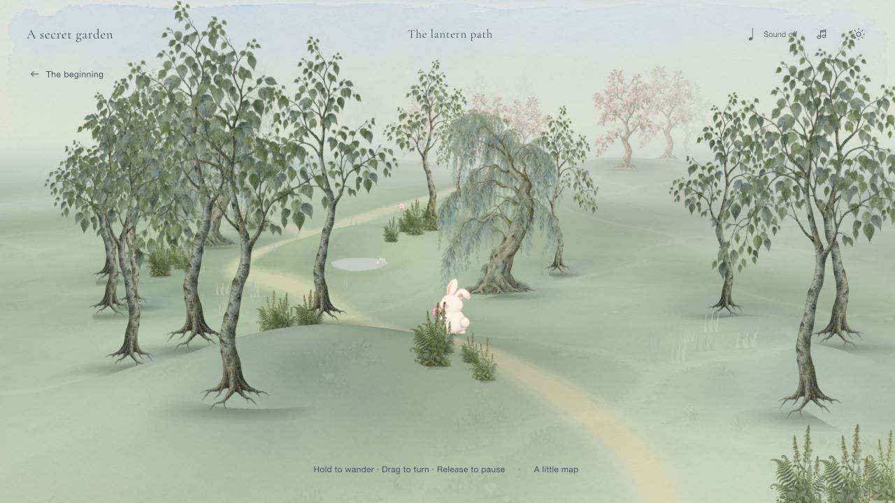
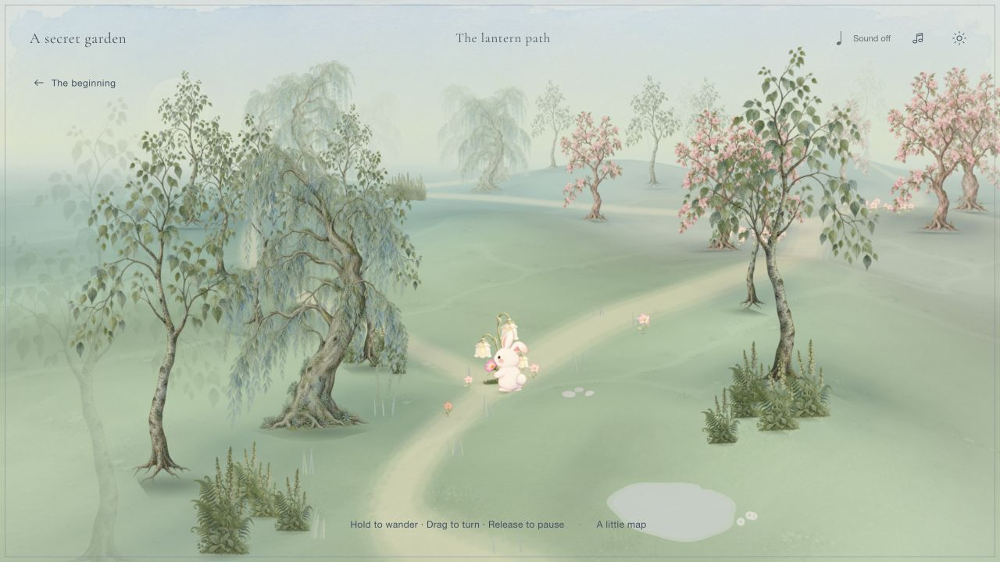

# 首段路线与八向小兔 · 桌面检查

日期：2026-11-01（Asia/Shanghai）。范围为 M1 桌面艺术样片；本轮不实施手机适配或部署。原始交接、用户参考图/视频和历史版本保留。

## 实际交付

- 八方向 × 三姿态的小兔：按下预备、头先转向、身体跟随、松手后原地落地。鼠标仍是按住引导、拖动转向、松手停止；可以同时沿两个轴移动。
- 入口到花灯由约1,223延长为3,316世界单位。按最高速度240单位/秒计算，理论纯行走约13.8秒；不是已经达到60–90秒的探索节奏。
- 首段增加弯道、树丛取景、坡面和空地；冷色远雾、较暖小路、根部阴影、局部遮挡与统一风场协调空间。
- 驻足首花后开花并显露蝴蝶；蝴蝶沿弯道等待/引路；花灯唤醒已经走过的局部痕迹；真正走回首花有一次返程回应。所有环境发现可跳过，不改变原谜题、音乐或礼物规则。

## 浏览器操作证据

使用 Codex 内置浏览器，实际页面视口1280×720，运行地址 `http://localhost:5173/`。通过原生鼠标按住、拖动、键盘、滚轮和页面控件检查；DOM仅用于读取公开的角色/镜头/事件状态，没有注入内部状态或合成移动事件。

操作记录：[browser-checks.json](qa/first-trail-refinement/browser-checks.json)。归档状态的比较断言：[assertions.txt](qa/first-trail-refinement/assertions.txt)。浏览器采集到的警告/错误列表：[console.json](qa/first-trail-refinement/console.json)，为空。

| 操作 | 实际结果 |
| --- | --- |
| 入口按住朝右前方走 | 角色由 `(0,-1800)` 走到约 `(266,-1184)`，角色与镜头分别更新 |
| 松手并在花边等待 | 角色、镜头、朝向、缩放精确不变；驻足后记录 `trail-flower-open` |
| 按住时斜向拖动 | 世界X、Y均改变，朝向随引导转弯，没有单轴锁定 |
| 坡面转向 | 实际发现坡面投影使方向翻转；修复后相同2.5秒西北引导可持续推进 |
| 自然步行至花灯 | 无地图传送，先后经过蝴蝶停点并抵达花灯，记录 `trail-lantern-awake` |
| 打开内容后在背景拖动 | 阅读期间位置和环境事件不变化 |
| 关闭内容面板 | 角色坐标、镜头坐标、朝向、缩放、已有事件与打开前精确相同；最终渲染版本再次通过 |
| 自然沿路返回 | 走回首花约 `(323,-1086)`，记录 `trail-guide-homeward`、多个返程停点及 `trail-returned`；之后走回入口 |
| 减少动态切换 | 原位置、镜头、朝向与事件不变，静态画面保留花与灯的记忆；切回WebGL恢复 |
| 方向键与滚轮 | 方向键可走，释放停止；滚轮推进后自行停稳 |
| 刷新 | 当前历史位置/朝向恢复；本次浏览环境记忆重置，符合当前会话设计 |
| 最终返程坡脊停留 | 相机抬高、坡脊降低后，兔子下半身可见；停留前后位置、镜头精确相同 |

完整因果往返在最终配色与构图微调前完成。微调时一次Vite热更新重建了会话；随后重新走完入口到花灯、面板开关和返程坡脊，最终截图与完整因果往返截图分开保留，没有把它们冒充同一次浏览。浏览器实际检查到蝴蝶返程中段；蝴蝶全部返程停点由确定性路线检查覆盖。

## 实际截图

以下均来自运行页面，不是概念图。

入口，最终构图：

途中，坡面与转弯：

花灯目的地，最终构图：

其他证据：

- [驻足开花](qa/first-trail-refinement/02-flower-final.jpg)
- [内容面板](qa/first-trail-refinement/05-reading-panel.jpg)
- [实际走回首花的回应](qa/first-trail-refinement/06-return-flower.jpg)
- [修正后的返程坡脊](qa/first-trail-refinement/06-return-ridge-final.jpg)
- [静态环境记忆](qa/first-trail-refinement/07-static-memories.jpg)
- [只显示已发现地点的地图](qa/first-trail-refinement/08-remembered-map.jpg)

`03-bend-exit-before.jpg`、`06-return-occlusion.jpg` 等中间问题截图留作修复记录，不是最终效果。

## 检查与构建

本轮已通过以下确定性检查：

| 脚本 | 覆盖重点 |
| --- | --- |
| `scripts/check-content.mjs` | 英文内容与既有固定规则 |
| `scripts/check-rabbit-animation.mjs` | 八向、取帧、方向滞回、起步/落地连续性（13组） |
| `scripts/check-living-motion.mjs` | 停止、双轴转向、坡面输入、镜头恢复（17组） |
| `scripts/check-trail-awakening.mjs` | 开花、引路、不同速度的真实往返、静态状态（10组） |
| `scripts/check-depth-world.mjs` | 透视深度与投影（7组、144个投影点） |
| `scripts/check-first-trail.mjs` | 路程、坡度、遮挡射线、入口揭示、雾色（5组） |
| `scripts/check-walkable-ground.mjs` | 可行走范围与地面覆盖（7组） |
| `scripts/check-garden-atlas.mjs` | 八区域、路径网络、真实入口坐标与边界（9组） |

`sh scripts/project.sh check` 通过。最后一次 `sh scripts/project.sh build` 在最终代码修改后通过，86个模块，Vite7.3.7：入口JS290.02KB、场景50.90KB、motion70.04KB、Three894.93KB（gzip242.82KB）。Three仍有超过650KB的分包提示，不是构建错误。

`src/` 与 `index.html` 未发现中文字符。交付前本地5173返回HTTP200，浏览器停在入口探索画面。

## 新素材与限制

新增斜向小兔由内置ImageGen依据本项目原兔子生成，原四向素材保留。源图 [rabbit-diagonal-v1.png](art-source/awakening/rabbit-diagonal-v1.png) 为1024×1536 RGBA；完整提示见 [rabbit-diagonal-prompt.txt](art-source/awakening/rabbit-diagonal-prompt.txt)。运行素材 `public/assets/garden/rabbit-diagonal-v1.webp` 为356,510字节；按实测透明轮廓取帧，运行时统一站立尺度。

- 仍是每方向三姿态配合变形和过渡，不是完整骨骼动画；持续运动的细腻度仍有提升空间。
- 目前重点打磨首段，其他区域尚未达到同样的细化程度；不宣称已经达到Wayfinder的探索密度或精致度。
- 静态替代保留位置和环境状态，但地面/遮挡为近似，切换时兔子视觉脚点可能小幅变化，不与WebGL逐像素一致。
- 未进行FPS基准、声音听感、跨浏览器或手机验收。本轮没有成功完整游玩Wayfinder原站；此前只核对其官方说明和操作提示，不将官网介绍当作亲自试玩结果。
- 环境声默认关闭；真实演奏、语音及完整谜题、音乐和礼物业务仍属后续M2—M5。

## 再次打开

预览：[http://localhost:5173/](http://localhost:5173/)。若本地进程已经退出，在项目根目录运行 `sh scripts/project.sh dev` 并保持进程运行。没有配置系统自启动或公开部署。
