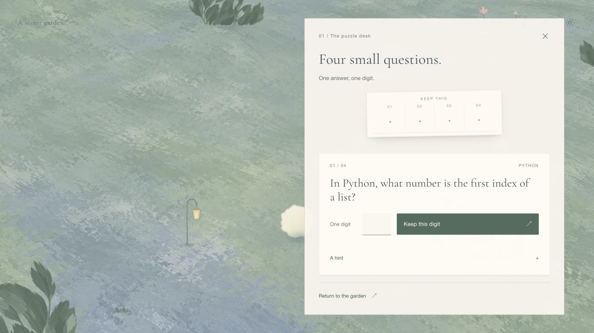
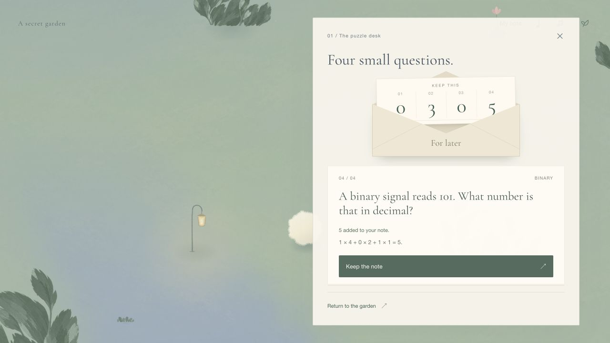
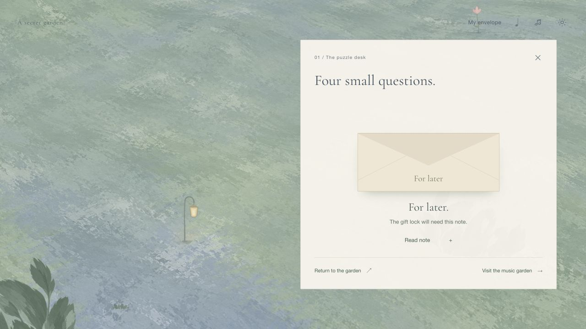
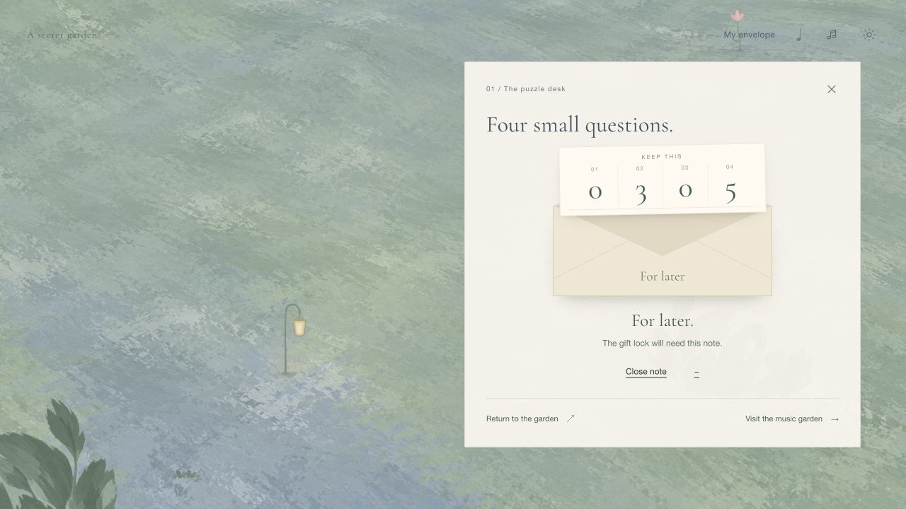

# 四道计算机知识原题 · 桌面检查

日期：2026-11-02。范围：恢复用户明确提供的原题与纸条／信封流程，网页英文。原交接包、参考素材及历史 QA 保留。修改前备份在 `versions/before-four-question-puzzle-20261102.tar.gz`。

## 当前规则

Python 首索引 0 → TCP 三次握手 3 → XOR 相同输入 0 → 二进制 101 转十进制 5。每道题单独输入一位；答案留在纸条，主动翻下一题；四位完整后可收进小信封。第一关不消耗密码、不自动打开礼物、不揭示生日。密码仍为后续礼物锁的 0305。完整规格见 [FOUR_QUESTION_PUZZLE.md](FOUR_QUESTION_PUZZLE.md)。

## 自动检查与构建

73 项相关检查通过：谜题与存储 18、礼物状态 13、音乐状态 15、音乐复制 8、礼物解锁 10、歌曲抽取 8、内容 1。测试涵盖顺序、前导零、错误输入、未完成不能装信封、独立曲目／礼物状态，以及旧 v1 迁移只保留有效曲目和已解锁礼物、不伪造新题答案。原 v1 不修改、不删除。

TypeScript 与 Vite 生产构建通过。Three 分包仍为 882.25 kB，构建有现存体积提示。未新增依赖或改变行走参数，不用旧运动验收冒充本轮设备复测。

## 实际浏览器检查

在独立生产预览 127.0.0.1:4184 空进度进行，使用真实输入框、按钮、浏览器刷新与后退；未注入状态或事件。1280×720。

- 第一题输入 1 拒绝且保留输入；改成 0 后纸条只留第一位，说明出现并等待 Next question。
- 关闭题桌返回花园，角色 X/Y、镜头 X/Y/zoom、朝向 X/Y 七项值与进入前一致。后退再次打开题桌续到第二题。
- 第二题填 3 未提交时刷新，输入和第一位已收数字均保留。
- 第二题 3、第三题 0、第四题 5 逐一验证，纸条最终为 0305。第三题提示可展开，不替玩家作答。
- 四题完成时，礼物仍锁着，曲目仍未抽取。
- 点击 Keep the note 后立即刷新，信封已保存；Read note 可以再次取出查看全部四位。
- 从音乐页到礼物锁输入 0305，出现实际护照夹／睡眠眼罩揭晓。
- 另一独立 origin 使用静态背景、开启 Reduce motion，再完成四题；收信封直接完成，不依赖动画或延时。
- 首次发现第四题完成画面底部被挤出，定向减少 40px 后重建重测：面板 clientHeight 与 scrollHeight 均为 645，footer bottom 为 664.33，全部位于 720px 视口内。
- 最后打开 localhost:5173/#puzzle，原有曲目 songId 7 和礼物解锁状态仍在，新四题为未回答。该页和正常流程未捕获 error/warn。

证据： [browser-evidence.json](qa/2026-11-02-four-questions/browser-evidence.json)。

## 实测边界

此次内容流程通过界面快捷入口验证，没有重走完整自然探索路线。未测试实体触摸板、音频听感、FPS、手机或现场断网；存储不可用与迁移异常分支由自动检查覆盖。并未将这些列为浏览器实测通过。九首真实曲目仍待提供；礼物照片、理由和称呼仍为空；本地备用包不代表公网发布或最终赠送版。礼物门沿用现有图示，本轮未重新设计实体礼盒美术。

本轮未声称完成此前送礼文案的重新润色。主服务继续在 localhost:5173，临时生产检查服务在检查后关闭。
