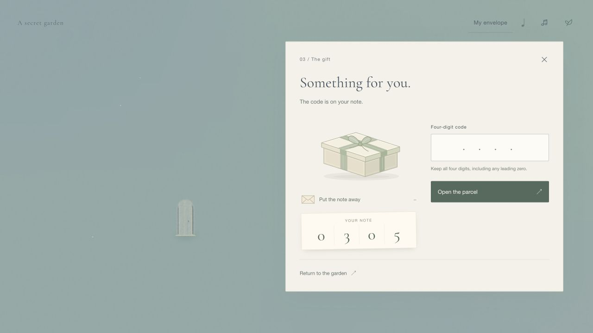
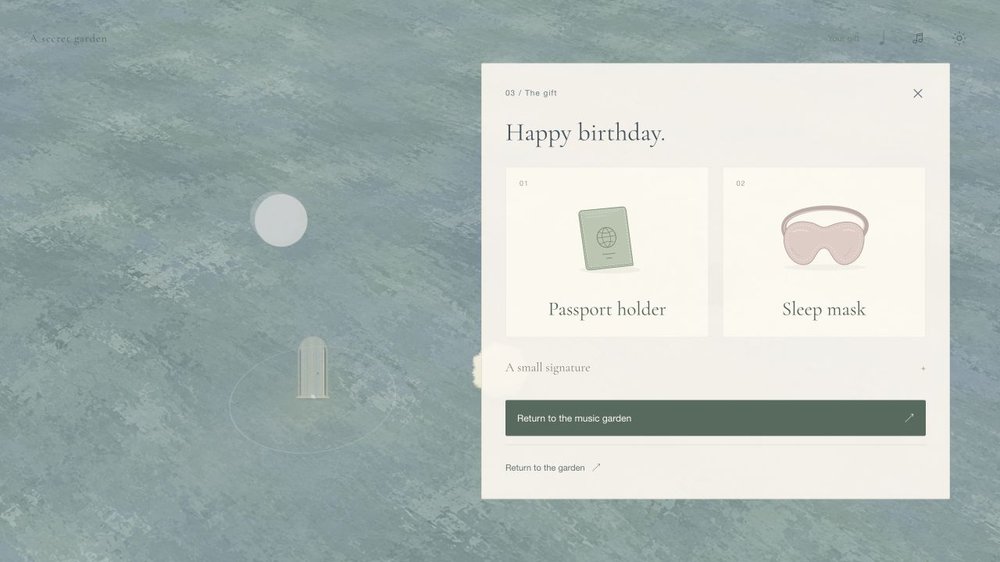

# 礼物锁旁信封与两件礼物揭晓 · 桌面检查

日期：2026-11-02。按用户确认的下一步完成纸条到礼盒的衔接与精简英文揭晓。原谜题四题／0305、九首等权有放回抽曲、业务存储与导航控制器保持原规则。原小门继续作为花园地标，礼物面板内改用礼盒。备份：`versions/before-gift-parcel-20261102.tar.gz`。

## 本轮实现

- `getGiftNote` 从四道题实际通过的输入和数字提取纸条，保留前导零。仅有完成标志或旧礼物解锁，不会生成纸条。
- 密码锁旁直接展开信封；已完成但未装信封者显示 Read my note。开合仅改变本地显示，保持密码草稿、路由、角色、曲目及所有业务进度。
- 奶油纸盒与浅绿丝带：原同步保存和 900ms 生命周期不变，抬盖／松结替代开门反馈；动画不决定权限。
- 揭晓分为 Passport holder 与 Sleep mask 两张物件卡，原创 SVG 中性示意；没有用户实物照片，不虚构品牌或具体款式。空理由／人名不展示。
- 删除生硬的见面交付与结束段落。Happy birthday. 为主祝福；A small signature 按需展开 03 / 05 — my birthday.，仅存在于已解锁页面。
- 署名 summary 可使用 Enter，参与父级 Tab 焦点循环。减少动态覆盖新纸条、盒盖与物件出现动画。

## 自动检查

32 项通过：新纸条 helper 8，礼物状态 13，解锁生命周期 10，英文内容／固定规则 1。新增检查覆盖未答／部分／草稿不泄露数字、伪造完成标志、正确顺序与零、已收／未收、非法结构、与曲目／礼物独立、返回新数组且不修改原状态。原生命周期检查涵盖连点、先保存、刷新基础、隐藏／卸载／减少动态和异常可重试。

TypeScript 与最终 Vite 构建通过。Three 882.25 kB 的既有体积提示仍在。没有新增依赖，未改角色输入和场景运动参数。

## 实际浏览器

1280×720。独立 127.0.0.1:5181 开发预览从空进度检查；localhost:5181 为另一空进度 origin 验证拆封中刷新。最终生产构建 127.0.0.1:4186/?static 开启 Reduce motion 验证。通过公开界面填写、点击、刷新、后退，未注入状态或模拟业务数据。

1. 空进度直接 #gift 只出现密码锁；礼物正文和纸条按钮均不存在。
2. 实际回答四题、收信封，从音乐页抽一首歌，再到密码锁。输入 0304 失败后，展开／收起信封仍保留 0304 与错误提示，未自动填 0305。输入和按钮均可读、未被面板裁切。
3. 展开可见四位 0 / 3 / 0 / 5；正确提交后 giftUnlocked 先为 true，界面仍在 opening 且盒盖动画为 parcel-lid-lift，随后显示两件礼物。
4. 展开小署名时 Enter 生效，Tab 转到返回音乐按钮且仍在对话框内。关闭后角色 X/Y、镜头 X/Y/zoom、朝向 X/Y 七项完全恢复；drawId 未改变。
5. 独立空进度直接输入 0305，在 DOM 仍为 opening 时刷新；回来保持已解锁，See your gifts 可重看，揭晓刷新也保留。没有额外授予四题进度、信封或歌曲。
6. 最终生产版本静态背景 + Reduce motion 中再次完成四题；锁旁展开纸条时输入仍为空。正确码立即揭晓，纸条和物件的 computed animationName 为 none。
7. 本机 5173 已更新，原曲目和旧解锁保留。正常与生产检查未捕获 error/warn。主预览服务保留，临时服务检查后关闭。

证据：[browser-evidence.json](qa/2026-11-02-gift-parcel/browser-evidence.json)。

## 限制与下一步

这是内容面板与衔接检查，通过快捷入口进入各地点；没有把它当作入口至终点自然行走节奏验收。实体触摸板、音频、FPS、手机和现场断网本轮未测。九首曲名等待用户提供；礼物图示并非真实实物照片。尚未公网部署，不代表最终赠送内容全部齐备。
