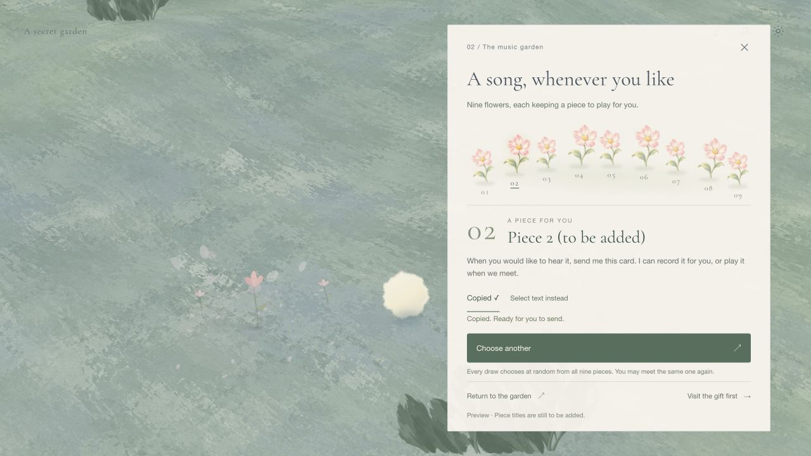

# M3 音乐花圃检查

日期：2026-11-02（Asia/Shanghai）。范围为桌面音乐抽取、保存、曲目卡与复制。原美术、移动版本 `soft-turn-stop-v3`、谜题和礼物规则保持。原文档与参考未改；本地预览未部署。

## 实现

- 九首固定 ID 1–9，每次主动抽取只取一次随机值，各编号占同样宽度的区间，独立、有放回。连续相同编号仍有新的 drawId。
- 业务状态同步保存后再开始 1.15 秒花朵反馈；定时器负责结束反馈，不依赖 CSS 动画完成事件。快速重复触发被同步锁拦住。
- 刷新恢复最近结果；离开、页面隐藏或减少动态不会重新抽取。静态模式直接显示结果，仅保留 180ms 防连点窗口。
- 九花位置固定；单花仅点头回应，抽取不会删除、重排或按权重选花。沿用本地 `quiet-flower.webp`，没有新增下载素材。
- 曲目卡显示两位编号、标题、可选理由、演奏邀请；复制和手动选中文字都使用当前编号及配置标题，不打开聊天应用。
- 所有音乐操作只改变 lastDraw。仍可不解谜直接进入音乐页；礼物入口当前只到 M4 预览。

## 实际浏览器结果

本机内置浏览器，1280×720，访问 `http://localhost:5173/#music`。数据见 [browser-evidence.json](qa/2026-11-02-music/browser-evidence.json)。

| 检查 | 结果 |
| --- | --- |
| 首次进入与触碰单花 | 九朵花全部加载；触碰 05 仍无抽取结果。 |
| 双击抽取 | 一次结果 09；抽取反馈期间按钮禁用。 |
| 动画中刷新 | drawId 保持 `39c18a21-605d-4790-bc12-5ee15723d3f1:1`，编号仍为 09，直接显示结果。 |
| 复制成功分支 | 浏览器 writeText 返回成功后才出现 Copied；没有打开外部聊天或发送消息。 |
| 主动手动复制 | 只读文本获焦，97 个字符全部选中；编号 09 与曲名正确，不创建新 drawId。 |
| 再进音乐页 | 同一 09 和 drawId 保留。 |
| 音乐→礼物预览→花园 | actorX/Y、cameraX/Y、cameraZoom、headingX/Y 七个值与离开前精确相同。 |
| 未解谜独立使用 | 全流程 puzzleSolved 保持 false，卡片仍在 bits 阶段。 |
| 减少动态与键盘抽取 | Enter 抽得 02，静态渲染直接显示结果；180ms 后按钮可用且曲名标题获焦。 |
| 键盘焦点与关闭 | Tab 从最后按钮回到关闭按钮，Shift+Tab 反向循环，Escape 返回花园并恢复入口焦点。 |
| 最终桌面排版 | 动态模式复制成功状态下面板高 641px，scrollHeight 641px，所有内容在 720px 视口内。手动文本展开时允许面板滚动。 |
| 控制台 | 本次预览日志未见 error/warn。 |

最终结果截图：

其他截图：[首次未抽取](qa/2026-11-02-music/01-ready.png)、[手动选择文字](qa/2026-11-02-music/03-manual-copy.png)、[减少动态](qa/2026-11-02-music/04-reduced.png)。首次截图拍于花圃高度最终缩小 15px 之前；最终排版以上图为准。

## 确定性检查与构建

2026-11-02 最终执行均退出 0：

| 命令 | 结果及范围 |
| --- | --- |
| `node scripts/check-music-progress.mjs` | 15/15：等分随机边界、连续同曲、唯一事件、无关进度不变、严格恢复、真实 hook 同步保存、连续命令与存储失败。 |
| `node scripts/check-song-draw.mjs` | 8/8：真实 hook 的提交顺序、同步锁、计时结束、卸载、隐藏、静态切换、effect 重放与错误恢复。 |
| `node scripts/check-music-copy.mjs` | 8/8：真实组件复制处理器；成功后确认、拒绝/缺 API 手动替代、旧 Promise 在新曲目或卸载后不污染 UI。 |
| `node scripts/check-puzzle-progress.mjs` | 18/18：原谜题和存储回归。 |
| `node scripts/check-content.mjs` | 英文内容树、固定规则、路由及独立空进度校验通过。 |
| `sh scripts/project.sh build` | TypeScript 与 Vite 生产构建通过；Three 分包仍约 895kB，构建继续提示体积偏大。 |

Node 使用本机 Codex 运行时；命令路径见根 README。M3 前备份为 `docs/versions/before-m3-20261101.tar.gz`。

## 尚未完成／限制

- 用户确认九首曲目已确定、将提供；本次尚未收到具体列表。保留明确待填标题，理由为空时不显示，音频未提供、不生成播放器。
- 实际浏览器已验证 writeText 的成功返回，但浏览器检查接口的剪贴板读回为空，因此没有确认系统剪贴板读回。手动选择内容已实际验证；拒绝权限分支由真实组件加模拟拒绝 Promise 验证，没有声称做了真实浏览器权限拒绝测试。
- 存储失败和重复同曲用确定性测试验证；没有人为修改用户浏览器存储或强制随机数。
- 没有新增实体触摸板手感、音频听感、FPS、手机或部署验收。M4 礼物解锁与揭晓尚未实现，深处美术和整体探索节奏也不因此被视为完成。
