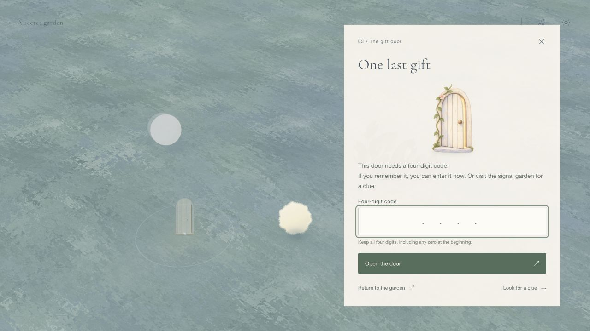
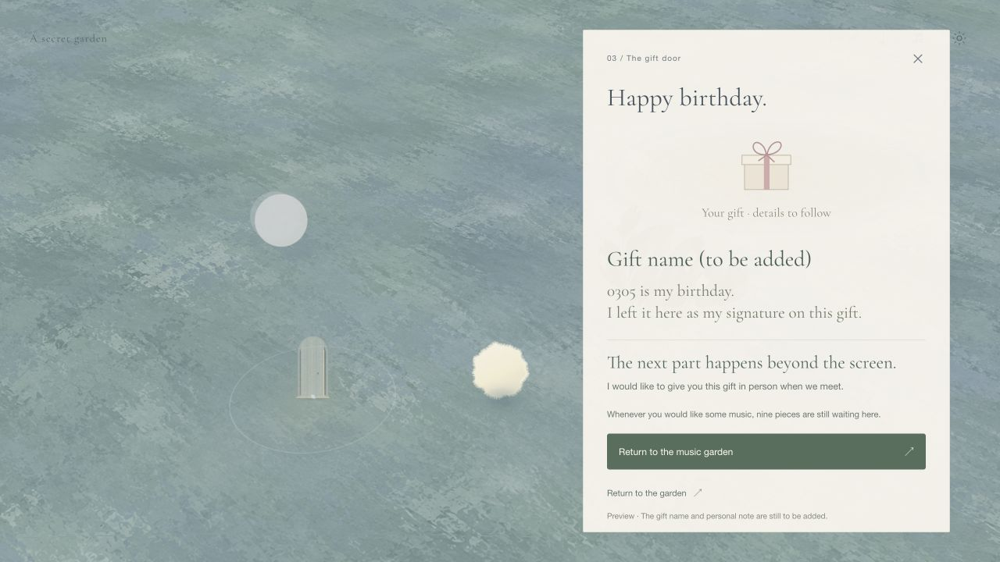

# M4 礼物门与揭晓检查

日期：2026-11-02（Asia/Shanghai）。桌面优先，保留水粉场景、绒团和 `soft-turn-stop-v3`。本轮完成礼物功能；真实曲名、礼物名称／照片／理由和称呼尚未收到，内容接入不计为完成。

## 行为与来源

- `acceptGiftCode` 只接受 trim 后等于 `0305` 的四位数字字符串；不转换成数字、不补零。单个真实文本框支持完整输入、粘贴和 Enter，错误时保留内容，不限制重试次数。
- reducer 的 `unlock-gift` 仅设置 `giftUnlocked`，不修改两张谜题卡、`puzzleSolved`、`bridgeSeen` 或 `lastDraw`。保存发生于视觉反馈之前。
- 开门为 900ms 面板内的短动效，动画不创建权限；减少动态直接转入正文。卸载取消计时器，隐藏或切换减少动态可结束等待，父组件只有在实际已解锁状态下才接受揭晓请求。
- App 的导航控制器统一维护原位置。gift 视图使用 lock 的空间位置，跨面板保留原始返回快照；揭晓本身不再移动镜头。所有入口均有守卫，未解锁礼物正文不会挂载。
- 门内按照片／占位、名称、可选理由、生日署名、现场交付、音乐回访呈现；没有自动跳走或倒计时。
- 复用 `/assets/garden/quiet-door.webp`；门叶反馈为 CSS 裁切与变换。中性礼物盒为明确的缺图占位，不是对真实礼物的描绘。没有新增外部图片、私人音频或播放器。

## 实际浏览器检查

视口 1280×720。主预览 `localhost:5173` 保留最近曲目 02、谜题未完成；既有 `127.0.0.1:5173` 预览已有完成的谜题且未抽歌。额外使用临时 `127.0.0.1:5180` 生产预览验证全空进度，不清除用户浏览器存储；临时服务已在检查后停止。

证据：[browser-evidence.json](qa/2026-11-02-gift/browser-evidence.json)。

| 场景 | 实测结果 |
| --- | --- |
| 未解锁直达 `#gift` | URL 校正为 `#lock`，显示四位输入框并获得焦点；DOM 无生日解释。 |
| 输入 `305`、`9999` | 均未解锁，输入保持原样，显示温和错误与找线索入口。 |
| 正确密码双击开门 | 反馈仍为 opening 时 `giftUnlocked=true`、storageStatus=saved；谜题 false，曲目 02 的 drawId 不变。 |
| 开门动画中刷新 | 恢复已解锁的门，直接提供 See your gift again，不要求重新输入，也不自动解释生日。 |
| 揭晓及刷新 | 显示配置中的生日说明与明确礼物占位；`#gift` 刷新仍为 revealed。 |
| 跨面板返回 | 音乐→门→礼物→音乐→礼物→关闭后 actorX/Y、cameraX/Y、cameraZoom、headingX/Y 与记录的原位置精确一致。 |
| 音乐独立性 | 全程原 lastDrawId、songId=02 保持；重新打开没有抽取新歌。 |
| 已解谜错误提示 | `305` 提示查看密码卡；密码卡入口实际打开已完成的两组与 `0305` 卡片。 |
| 无 WebGL 替代 | `?static` 下开门流程完成，既有谜题完成状态不变、lastDraw 仍为空。 |
| 全空进度／减少动态 | 临时生产预览中，无解谜也无抽歌，启用 Reduce motion 后 Enter 输入 `0305` 直接到 gift；puzzleSolved=false、两卡仍 bits、lastDraw 仍为空。 |
| 回访入口 | 顶部 Your gift 与音乐页 See the gift again 直接重看，不重复开门。 |
| 焦点 | 锁页输入首焦点，揭晓标题获焦；Tab／Shift+Tab 循环正确，Escape 返回花园。 |
| 历史 | 从花园后退到 gift，再前进回花园，七个位置／朝向字段保持。 |
| 排版／日志 | 默认占位揭晓全部内容适合 720px 高桌面；三处预览日志未见 error/warn。 |

门的实际截图：

揭晓实际截图：

另附：[空进度减少动态揭晓](qa/2026-11-02-gift/03-static-reveal.png)。截图为真实本机页面，未替换成设计稿。

## 自动检查

使用本机 Node 24 运行，脚本与源码均在项目内。

| 检查 | 结果 |
| --- | --- |
| `scripts/check-gift-progress.mjs` | 13/13：严格字符串密码、幂等、独立状态、守卫、恢复、真实 hook 同步保存、同帧混合动作、存储拒绝。 |
| `scripts/check-gift-unlock.mjs` | 10/10：真实 hook 的错误无副作用、防连点、提交先于视觉、900ms 结束、减少动态、卸载取消、隐藏、回调更新、effect 重放和失败重试。 |
| 谜题回归 | `check-puzzle-progress.mjs` 18/18。 |
| 音乐回归 | `check-music-progress.mjs` 15/15、`check-song-draw.mjs` 8/8、`check-music-copy.mjs` 8/8。 |
| 内容校验 | `check-content.mjs` 通过。 |
| 类型与生产构建 | `sh scripts/project.sh build` 通过；Three 分包约 895kB，仍有体积提示。 |

共 72 项行为检查通过，另有内容校验与构建。原位恢复、输入及路由证据来自真实浏览器；存储拒绝、卸载取消等生命周期边界由实际函数／hook 加可控 host 验证，不把它们冒充浏览器故障注入。

## 待补与未测

- 用户尚未提供九首实际曲名、礼物名称／可选理由／照片、称呼和署名；仍明确占位。本轮未用虚构私人内容填满页面。
- 已检查没有照片时的完整布局；尚无真实照片可检查取景与清晰度，图片加载拒绝分支未在浏览器中人为注入验证。
- 未重新验收实体触摸板、音频听感、FPS、完整自然步行节奏、手机或部署。没有宣称 M5 彩排完成。
- 本轮前版备份：`docs/versions/before-m4-20261102.tar.gz`。原始交接包和 reference 未改。
