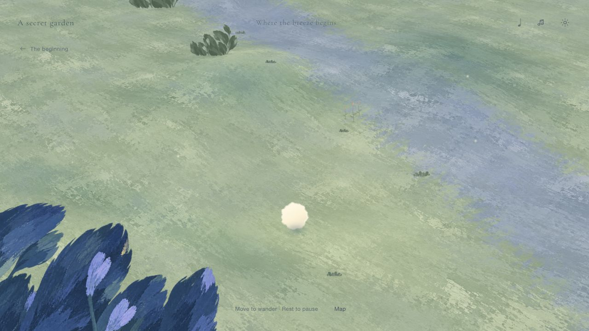

# 绒团移动同步检查 · 2026-11-01

本轮只修正移动顿挫。现有水粉美术、场景密度、谜题规则和存储保持原样；未推进 M3。

## 原因与修正

此前控制器使用独立 RAF，经 React 状态发布角色位置；Three 在另一套帧循环中绘制角色、跟随镜头和身体动态。两者错开时，一帧重复旧位置，下一帧补上较大的位移。身体动态再用位移除以绘制间隔估算速度，使重复帧和合并帧造成额外波动。

现在由 Three 绘制帧先推进控制器，再更新镜头、角色和环境，统一读取同一份实时状态；身体形变直接使用控制器速度。Canvas 避免因为连续位置更新而反复协调整个场景。静态替代仍有独立帧驱动，两种模式切换时转交输入，不同时推进两遍。

无按键引导、原有 380 ms 指针保持及 740 ms 停步期限不变。打开面板、离开窗口等取消操作立即停止实时状态；关闭内容恢复已保存的位置、镜头、朝向和缩放。

## 实际浏览器测量

本机 Chromium 自动化页、1280×720、开发构建，从入口 `(0, -1800)` 及同一朝向开始。通过实际移动积分器执行 8 秒固定方向变化，舍弃最初 500 ms。两次平均绘制调用分别为 52.74 / 52.70。

| 指标 | 修正前 | 同步后 |
| --- | ---: | ---: |
| 移动中重复旧位置的帧 | 192 | 0 |
| 帧间隔均值 | 9.99 ms | 8.34 ms |
| 帧间隔 P95 | 19.9 ms | 10.2 ms |
| 超过 25 ms 的帧 | 2 | 1 |
| 单帧位移 P95（世界单位） | 6.70 | 2.42 |

重复旧位置不是 GPU 丢帧计数。该结果证明本次固定输入下的位置采样更连续，不代表所有设备都能达到同样帧率；实体触摸板的舒适度尚待用户复测。

原始数据：[frame-measurements.json](qa/2026-11-01-motion/frame-measurements.json)。诊断界面：[measurement.png](qa/2026-11-01-motion/measurement.png)。开发环境显式使用 `?qa=motion` 才显示检查工具，普通页面及生产页面不显示。

## 回归结果

- 26 项指针／实际 hook 检查通过，覆盖短划、抬指、转向、静止、取消、两种帧驱动交接，以及 React 未提交时仍有连续实时位置。
- 7 项身体动态／实际组件检查通过，覆盖 30/60/120 fps、停步、阅读冻结和跳转时清除拖尾。
- 18 项谜题／存储及 10 项沿途唤醒检查通过。
- 实际浏览器打开密码卡后，角色与镜头保持冻结；关闭后七项坐标／朝向／缩放字段精确恢复，moving 为 false。静态替代保持位置。
- 新建普通预览页确认 `frame-sync-v2`、WebGL 正常、无诊断界面、无控制台 error/warn。类型检查和生产构建通过，Three 分包原有体积提示仍存在。

页面截图只用于确认美术和正常页面，不能证明动态顺滑程度：

本轮未验证实体触摸板、手机、音频或部署。修改前备份：`docs/versions/before-smooth-motion-20261101.tar.gz`。
