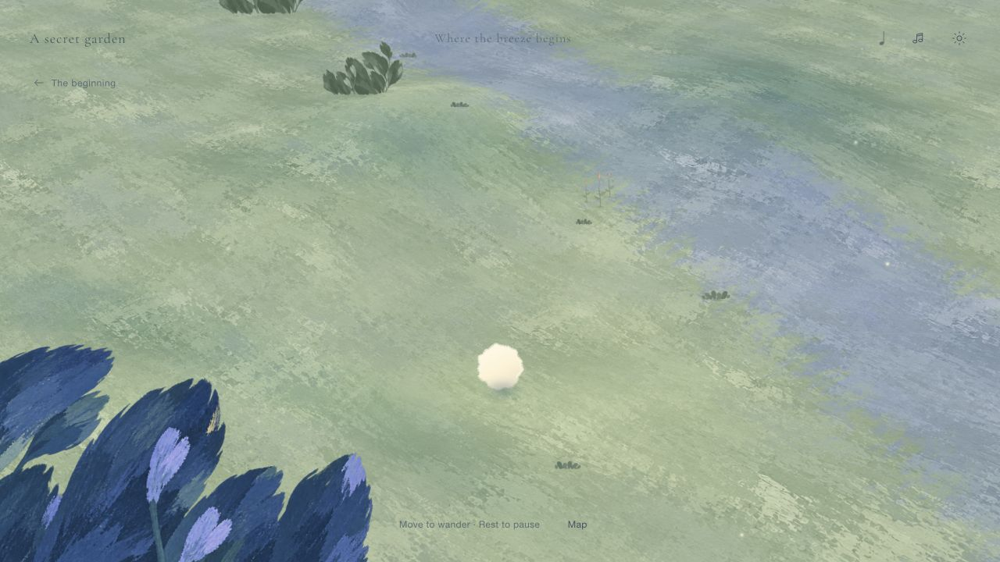

# 转向与停步收势 · 2026-11-01

用户复测确认连续行走已顺滑，但转向、停下仍生硬。本轮在同帧驱动基础上修正转身与镜头收势；保留现有美术、无按键引导及谜题规则。

## 改动

- 控制器记住上一帧角速度和加速度，通过阻尼曲线转向、改变速度，避免起转立即达到最大角速度、转完立即归零。
- 接近 180°时沿已选方向完成转弧，避免指针微小噪声令方向左右翻转。
- 自然停步使用有限时长曲线；延续当前速度及向下的加速度，末端速度和加速度均归零。原 380 ms 宽限、740 ms 静止期限不延长。
- 镜头在相同停步窗口内逐渐减小跟随位移，避免角色已经停稳但镜头仍以较高速度跟随，随后突然截停。途中恢复引导时继承当前速度和镜头权重。
- 点击、控件、面板、失焦、隐藏、跳转仍立即清空输入和动态状态；不把自然停步的余量带过这些取消边界。

## 量化检查

在同样的 60 fps 控制器脚本中：

| 指标 | 修正前 | 当前 |
| --- | ---: | ---: |
| 90°起转首帧实际角速度 | 4.80 rad/s | 0.96 rad/s |
| 自然停步最后移动帧镜头速度 | 57.09 世界单位/s | 0.0845 世界单位/s |

90°转向约 733 ms 进入 1°误差范围；此时角速度约 0.135 rad/s，继续衰减，末端没有硬切。相比旧版转身更缓，是否足够跟手仍需用户实际触摸板反馈。

新增 [check-turn-stop.mjs](../scripts/check-turn-stop.mjs) 的 9 项检查通过，覆盖 90°/180°、反转噪声、30/60/120 fps、有限刹停、截止后不漂移、转弯中停下、镜头收势、再起步和异常输入。镜头最后移动帧速度在三种帧率下分别为 0.076 / 0.084 / 0.095 世界单位/s。原 26 项指针／真实 hook 回归和 7 项身体动态检查通过；类型检查、生产构建通过。Three 分包体积提示仍存在。

## 实际浏览器

本机 Chromium、1280×720、开发构建，显式 QA 按钮通过真实控制器执行 90°转向、反向、停留、恢复及再次停留。8 秒测量中重复旧位置帧 0，帧间隔 P95 11.6 ms，超过 25 ms 的帧 0。脚本路线已包含停留，因此不能直接与上轮持续行走的帧数比较。

- 停下后再次读取坐标，角色、镜头、朝向与缩放没有漂移。
- 打开密码卡后关闭，七项坐标／朝向／缩放精确恢复，moving 为 false。
- 新普通预览确认为 `soft-turn-stop-v3`、WebGL 正常，无控制台 error/warn；普通页面不显示 QA 面板。

证据：[浏览器指标](qa/2026-11-01-turn-stop/browser-metrics.json)、[返回结果](qa/2026-11-01-turn-stop/return.json)、[检查界面](qa/2026-11-01-turn-stop/measurement.png)。

固定输入脚本和静态截图均不能替代实体触摸板手感验收。本轮未验证手机、音频或部署。修改前备份：`docs/versions/before-turn-stop-20261101.tar.gz`。
