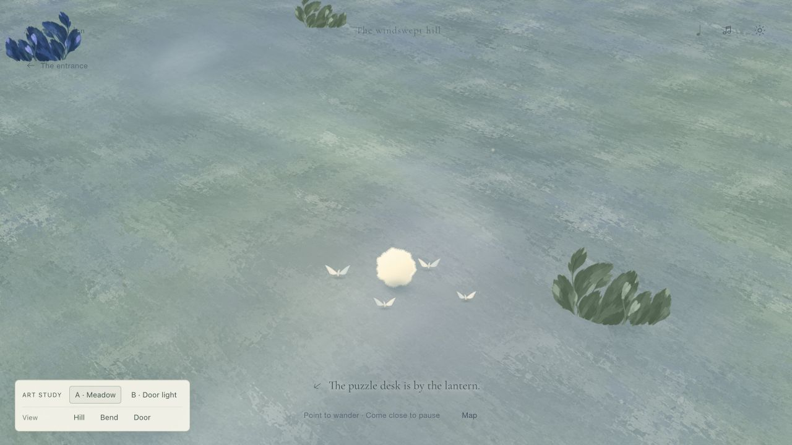
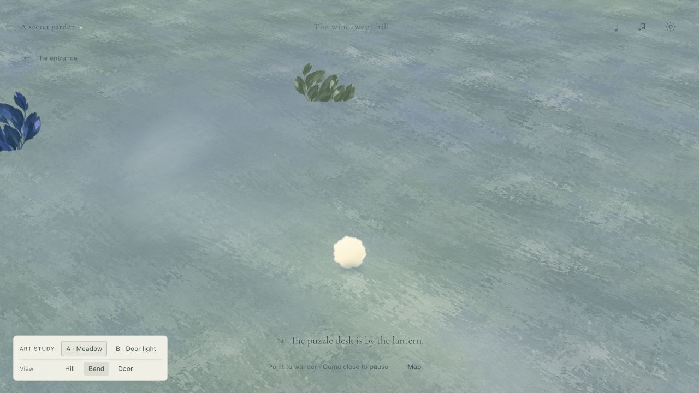
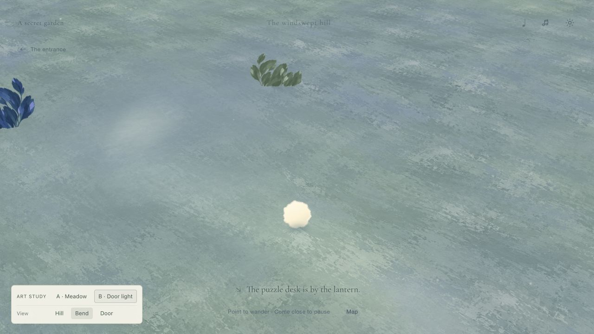
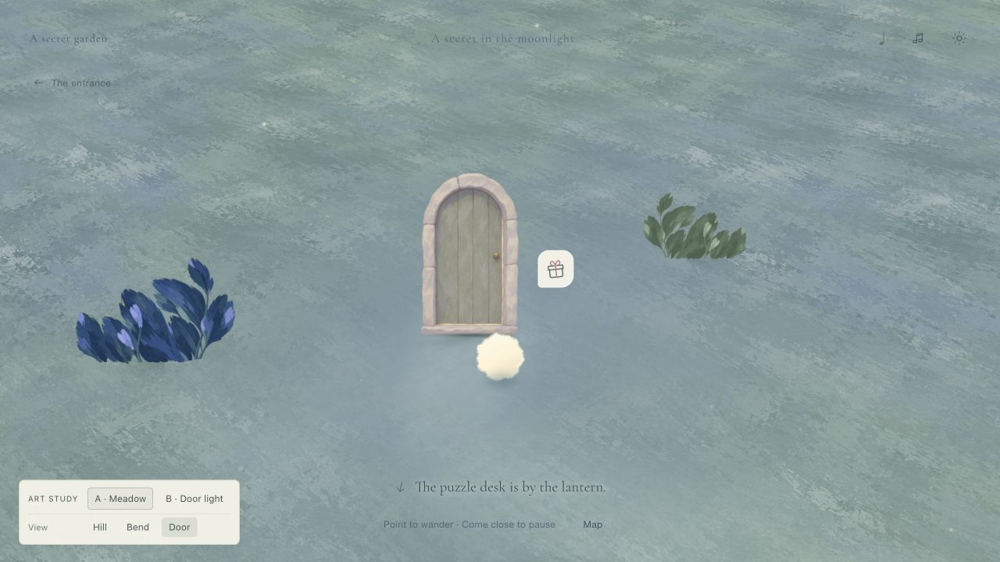
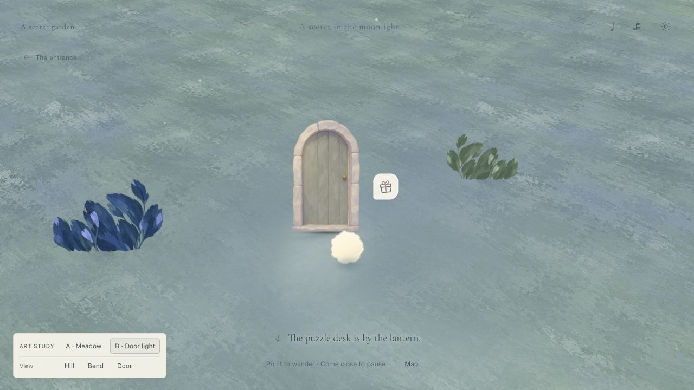
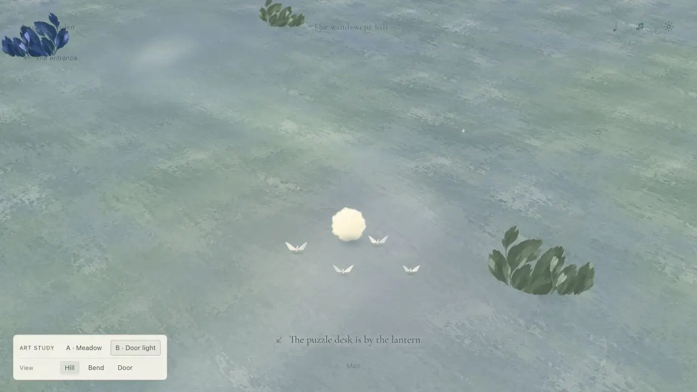
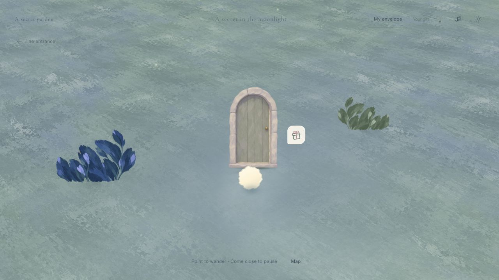

# 局部美术对照检查 · 2026-11-13

初次交付为独立的可操作 A/B 对照。用户随后选定 A，现已合入主预览 4198；下方对照记录保留为历史证据。

## 打开

- A（主建议）：http://127.0.0.1:4199/?art=baseline&spot=door&walk=art-study-review-20261113#garden
- B（小幅备选）：http://127.0.0.1:4199/?art=light&spot=door&walk=art-study-review-20261113#garden
- 左下 Art study 切换 A/B；Hill / Bend / Door 定位相同取景点。切换版本保留当前角色、镜头和朝向。
- 独立源代码与构建：`.visual-study-20261113/`。原 `src` 和 `dist` 保留，4198 仍提供原预览。
- 如对照服务退出，从项目根运行：
  `sh .visual-study-20261113/scripts/project.sh preview --port 4199`

## 改动边界

A 恢复圆圈改动前的草地 shader、地形和门旁两组植物的位置/尺度，移除圆圈、新增蓝色坡面及连续黄色亮路。保留现有行走、纸鸟引路、交互、密码和礼物代码。现有门脚阴影修正保留。

B 与 A 同布局，只加门框左上局部暖色、门槛附近小片受光、稍强接触阴影。没有扩大光斑、光路、地形或植物。

两版用同一构建、查询参数选择。对照工具只存在于隔离工程；预览定位不会完成谜题或解锁礼物。独立端口与 walk 标识不会清空原站进度。

## 实际检查

- TypeScript 检查与 Vite 构建通过；现有 walk-progress 检查 19 项通过。
- 1280×720 WebGL 实拍：丘陵、弯道、门前三组 A/B，角色坐标、镜头、缩放与朝向完全一致，记录见 `same-camera.json`。静态构图通过预览定位按钮取得，不冒充完整走路过程。
- 另从丘陵使用真实方向键连续走到门前，54 张实际截图组成约 12.4 秒动图 `hill-to-door.webp`。纸鸟触发，依次到达 1–7 处停落点；没有用定位按钮替代这一段行走。
- 到门前仍显示四位密码输入，未解锁时未显示礼物。关闭面板后角色和镜头精确恢复。
- 门侧行走后切换 A/B，角色与镜头精确保持；见 `interaction-checks.json`。
- A/B 减少动态模式均可显示；浏览器未记录 error/warn。
- 原站关键源码及 dist/index.html 与开始时 SHA-256 一致，见 `original-unchanged.json`；4198 和 4199 均返回 HTTP 200。

## 判断与限制

推荐 A 作为收回过度改造的基线。B 的暖色在门框上略可见，整屏差别很小，不把它描述为明显升级。

减少动态模式的地面比 WebGL 平：它原有的 soft-light 纹理混合和门前柔化抑制了纹理。本轮确认这段代码与圆圈改动前一致，没有擅自扩大修复范围。丘陵视角的远处蓝叶可与页眉重叠，记为现有构图问题。

本轮未重跑全程谜题/音乐/礼物解锁，未复测实体触摸板、声音、手机或公网部署。对照切换会重载页面，纸鸟等短暂环境动画会重新初始化；位置与业务进度保留。动图是实际截图序列，不能用其帧率判断游戏运行流畅度。

## 实拍

| 取景 | A | B |
|---|---|---|
| 丘陵 |  |  |
| 弯道 |  |  |
| 门前 |  |  |

## A 版采纳记录 · 2026-11-13

用户明确选择 A 后，将五个场景文件中的 A 渲染合入根目录，保留原 App、URL/进度管理和 ExplorationScene。B 光照、Art study 工具及其查询参数兼容代码未带入主站。备份为 `versions/before-promote-A-20261113.tar.gz`。

主预览 http://127.0.0.1:4198/#garden 已加载新的 `index-BKBXYiMZ.js`，实际桌面页面为 A 的连续草地、小型植物与原画着色，无对照工具；浏览器 error/warn 为空。未清空既有体验进度。

本次 TypeScript/Vite 构建通过；纸鸟引路21项、告别17项、到达状态16项、深度投影7项检查通过。到达状态检查中旧的物件变色断言已随采纳A改为保留原画颜色，纸鸟告别所需到达时序继续保留。未重跑全程业务或实体触摸板；减少动态模式偏平的既有限制仍在。

